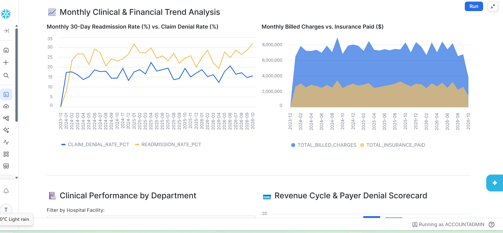
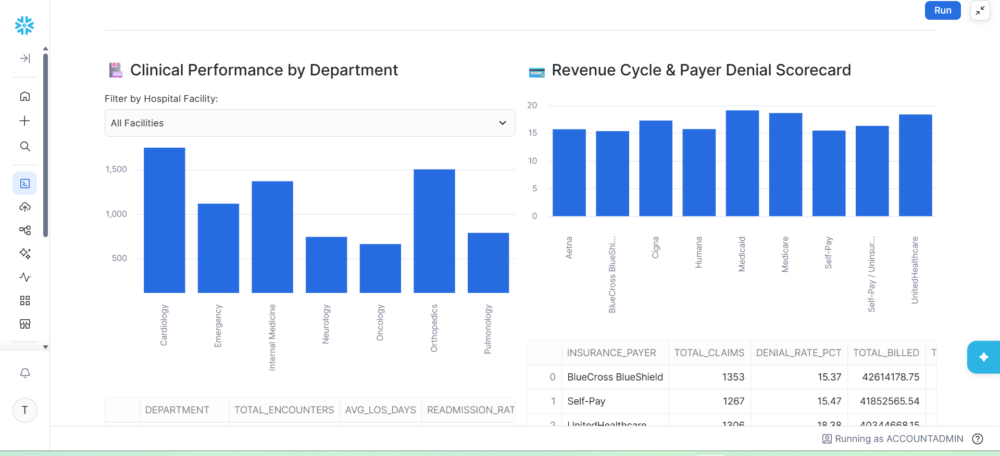
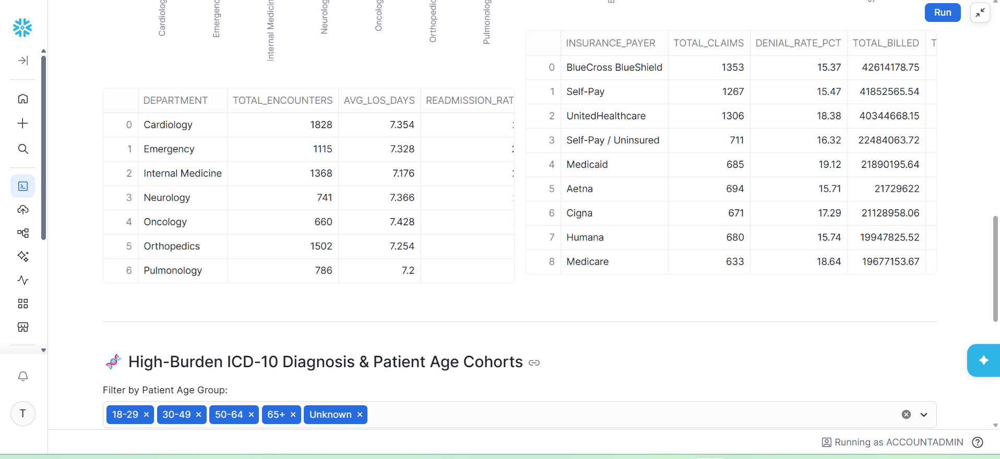
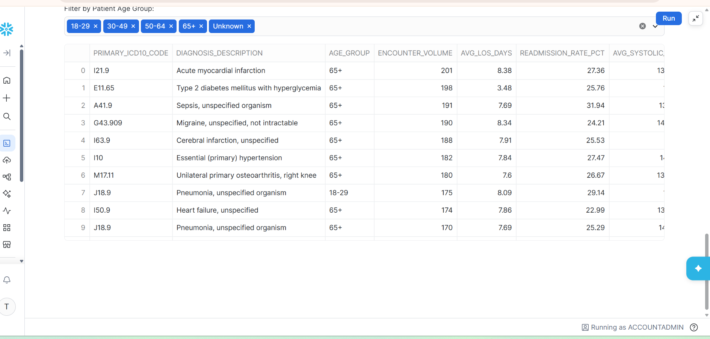

# Healthcare Clinical & Revenue Cycle Analytics

A **Streamlit in Snowflake** executive dashboard for hospital clinical and revenue-cycle performance. It runs natively inside Snowflake (Snowpark session) and reads from Gold-layer views in `HEALTHCARE_DB`, the top of a medallion pipeline (AWS S3 → Bronze → Silver → Gold).

## Screenshots

**Monthly clinical & financial trends** — 30-day readmission rate vs. claim denial rate, and billed charges vs. insurance paid:

**Department performance & payer denial charts:**

**Department & payer scorecard tables:**

**High-burden ICD-10 diagnosis cohorts:**

## What the dashboard shows

**Executive KPI cards** — Total Encounters, 30-Day Readmission Rate, Average Length of Stay, Total Billed Charges, Claim Denial Rate, Average Days in AR.

**Monthly trend analysis** — readmission rate vs. claim denial rate over time, and billed charges vs. insurance paid.

**Department & facility scorecard** — encounters, length of stay, readmission rate, cost per encounter, reimbursement, and provider satisfaction by department, with a facility filter.

**Payer denial analysis** — claims volume, denial rate, billed/allowed/paid amounts, average days to payment, and top denial reason by insurance payer.

**Diagnosis cohort explorer** — high-burden ICD-10 cohorts by age group: encounter volume, length of stay, readmission rate, average systolic BP, and average billed per case.

## Data sources (Snowflake Gold views)

| View | Powers |
| --- | --- |
| `HEALTHCARE_DB.GOLD.vw_monthly_executive_kpis` | KPI cards + monthly trends |
| `HEALTHCARE_DB.GOLD.vw_department_facility_scorecard` | Department/facility scorecard |
| `HEALTHCARE_DB.GOLD.vw_payer_denial_analysis` | Payer denial scorecard |
| `HEALTHCARE_DB.GOLD.vw_diagnosis_clinical_cohorts` | ICD-10 cohort explorer |

## Tech

- Streamlit in Snowflake (`streamlit[snowflake]`), Snowpark (`get_active_session()`), pandas
- Snowflake medallion architecture fed from AWS S3
- Deployment defined in `snowflake.yml` (database `HEALTHCARE_DB`, schema `GOLD`, warehouse `HEALTHCARE_WH`)

## Files

| File | Purpose |
| --- | --- |
| `streamlit_app.py` | The dashboard app |
| `snowflake.yml` | Streamlit-in-Snowflake project definition |
| `pyproject.toml` | Python/package configuration |
| `.streamlit/config.toml` | Streamlit theme configuration |
| `images/` | Dashboard screenshots |

## Running it

This app runs inside Snowflake, not locally — it needs an active Snowpark session and access to the `HEALTHCARE_DB.GOLD` views above. Deploy with the Snowflake CLI (`snow streamlit deploy`) from the project definition in `snowflake.yml`, or open it in a Snowsight workspace.
